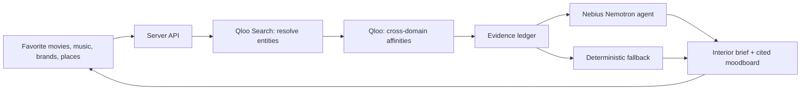

# TasteRoom — Taste-to-Space Agent

Turn favorite movies, music, brands and places into an interior brief with a visible reason behind each choice.

[Try TasteRoom](https://tasteroom-rho.vercel.app) · [Source](https://github.com/kks0488/tasteroom)

People know the culture they love; translating it into a room is harder. TasteRoom connects those favorites to cultural affinities and uses them as a starting point for design:

- **My Room:** an interior style brief, color/material palette, furniture and decor directions, lighting, conceptual moodboard and shopping checklist.
- **Shared Space:** compare two taste profiles, find common ground and keep individual corners.
- **Storefront:** explore a neighborhood and optional brand references for a shop concept, with an illustrative budget.

## Quick start

Requires Node 22.12+. Run installs, builds and browser checks on `pilot` when working from a low-memory Mac.

```sh
npm ci
npm test
npm run build
npm run dev
# http://127.0.0.1:4173
```

With no keys, the app uses explicitly labeled **fictional tastes and synthetic fixtures**. These are not Qloo results. To enable live mode, copy the empty template and set values privately in the server environment:

```sh
cp .env.example .env
# Fill .env privately; the tracked template contains only empty values:
# QLOO_API_KEY=
# LLM_BASE_URL=
# LLM_API_KEY=
# LLM_MODEL=
node --env-file=.env server/dev.js
```

Use `LLM_BASE_URL=https://api.tokenfactory.nebius.com/v1` and `LLM_MODEL=nvidia/Nemotron-3_5-Lightning`. Set deployed secrets with `vercel env add`; never put keys in browser variables or the repository. Live samples use real favorites such as **Amélie / Radiohead / MUJI** and **Spirited Away / Björk / IKEA**. Unknown or unavailable Qloo results produce an error rather than synthetic live evidence.

## How it works



- **Qloo:** server-only calls to `https://hackathon.api.qloo.com` use `X-Api-Key`. Search resolves favorites; Insights returns cross-domain affinities. Shared Space also uses comparison; Storefront explores location signals and audience affinities. [Qloo developer guide](https://docs.qloo.com/reference/qloo-llm-hackathon-developer-guide).
- **Nebius Token Factory:** `nvidia/Nemotron-3_5-Lightning` selects a design direction and supporting evidence through a bounded tool loop. A constrained renderer writes source names from the actual Qloo ledger and design suggestions from the selected room plan; unrestricted model prose is not presented as Qloo fact. If reasoning fails, a visible warning identifies the deterministic fallback.
- **React + Vercel:** the browser displays the brief and signal trace; API credentials stay on the server. Storefront photo previews remain in the browser and are not analyzed.

## Interpretation and limits

Colors, materials, furniture ideas and original room illustrations are TasteRoom interpretations, not Qloo product recommendations or measured design outcomes. Affinities describe cultural relationships; they do not prove personal preference, room suitability, local demand or commercial success. Shopping items are generic directions, not verified stock. Storefront budgets are illustrative USD estimates, not quotes; audience affinities are not a neighborhood census. Live Qloo failures never silently switch to synthetic success. Output badges distinguish live evidence from offline fixtures and show the planner used.

## What was built during the hackathon

TasteRoom's studio, original conceptual artwork, Qloo client, agent tool loop, evidence ledger, room/shared/storefront planners, export flow and tests were built for the Qloo Agentic Hackathon. This revival connects the existing application to real Qloo discovery and Nebius reasoning. React, Vite and other open source dependencies are credited to their authors. No Devpost submission is automated.

## License

MIT — Copyright (c) 2026 Kyoungsoo Kim. See [LICENSE](LICENSE).
