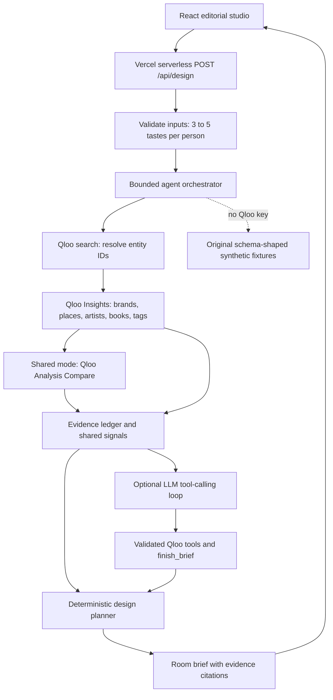

# TasteRoom

**Turn the culture you love into a room that feels like you.**

TasteRoom is an agentic interior design studio grounded in cross-domain cultural taste. It turns 3–5 favorite films, artists, places, books or brands into an actionable room brief, with an evidence trail from every color, material and furniture choice back to the taste signals behind it.

**Live demo:** [tasteroom-rho.vercel.app](https://tasteroom-rho.vercel.app). No login required. The initial deployment uses explicitly labeled synthetic demo data until the owner supplies a Qloo key.


## Problem

People know which music, films and places move them, but often cannot translate those preferences into an interior design vocabulary. Generic prompts such as “modern and cozy” flatten individual tastes. A shared home adds another problem: two people need a room that respects both of them.

## Solution

- A personal or shared-space studio, with living room, bedroom and home office briefs.
- An editorial moodboard with hex palettes, material textures, furniture direction and a three-scene lighting timeline.
- Clickable taste traces, resolved entities and an agent tool log.
- Shared Space compares two cultural profiles, shows overlapping and distinct signals, and preserves a personal corner for each person.
- A generic shopping checklist, copyable brief and print layout. No scraped products, affiliate links or outside imagery.
- A complete keyless demo with original fictional tastes. Unknown demo names are rejected rather than fabricated.

## Why Qloo is essential

Qloo supplies the cultural relationships that drive the design, rather than decorating an otherwise generic prompt. The agent resolves names, queries cross-domain brand/place/artist/book affinities and tag taste analysis, and compares two groups to discover shared cultural anchors. Changing the cultural input changes the selected design direction, palette, materials and personal accents. A missing or failed live Qloo response does **not** silently become a demo success.

The translation from cultural affinity into interiors is TasteRoom’s creative interpretation, not a claim that Qloo measures furniture or lighting preferences. With no LLM key, a bounded deterministic planner chooses from original design directions using the returned signals. With an LLM key and model, the agent uses an OpenAI-compatible tool-calling loop to explore Qloo and compose the direction and evidence-grounded explanations. Invalid evidence citations are discarded in favor of grounded planner explanations.

### Verified Qloo contract

Requests use `GET https://hackathon.api.qloo.com` with a server-side `X-Api-Key` header:

| Tool                  | Endpoint               | Parameters used                                                                                      |
| --------------------- | ---------------------- | ---------------------------------------------------------------------------------------------------- |
| Resolve tastes        | `/search`              | `query`, `take`                                                                                      |
| Cross-domain affinity | `/v2/insights`         | `filter.type`, `signal.interests.entities`, `take`                                                   |
| Tag taste analysis    | `/v2/insights`         | `filter.type=urn:tag`, `signal.interests.entities`, `take`                                           |
| Shared Space          | `/v2/analysis/compare` | `a.signal.interests.entities`, `b.signal.interests.entities`, `filter.type=urn:entity:brand`, `take` |

The official [Analysis Compare documentation](https://docs.qloo.com/reference/analysis-compare) specifies **`/v2/analysis/compare`**; this corrects the brief’s `/v2/insights/compare` spelling. No legacy recommendations endpoints are used. Insights entity results use `results.entities`, tag analysis uses `results.tags`, and search/compare use `results` arrays. Comparison anchor entities ground the shared brief’s explanations. The overlapping-signal lists are computed by matching identifiers from each group’s highest-ranked affinity results; they are not a Qloo compatibility percentage.

Official documentation was read with curl: [hackathon guide](https://docs.qloo.com/reference/qloo-llm-hackathon-developer-guide), [Insights deep dive](https://docs.qloo.com/reference/insights-api-deep-dive), [parameter reference](https://docs.qloo.com/reference/parameters), [entity type guide](https://docs.qloo.com/reference/available-parameters-by-entity-type), [search](https://docs.qloo.com/reference/get-search), [tag taste analysis](https://docs.qloo.com/reference/taste-analysis), and [compare](https://docs.qloo.com/reference/analysis-compare). Compare’s published item definition contains an unresolved external schema include, so live compare item compatibility still needs verification with a real key. The UI deliberately avoids unsupported percentages.

## Architecture



The agent is a custom tool-using orchestrator; no agent framework is claimed. A client is created per design request, with in-flight deduplication, private request-scoped caching, a 32-call cap and 8-second Qloo timeouts. LLM reasoning is bounded to three rounds with 10-second provider timeouts. Keys stay on the server. Profiles and live Qloo responses are not persisted or checked into the repository.

## Run and test

Node.js 22.12 or newer is required. On a low-memory Mac, run installs, builds, servers and browsers on `pilot`.

```sh
npm ci
npm test
npm run build
npm run dev
```

Open `http://127.0.0.1:4173`. With no environment variables, the entire flow works using fictional samples. Choose **Just for me → Translate my taste**, inspect a taste trace, then choose **A shared space → Find our common ground**. Change the room type to see different anchor furniture and lighting scenes.

Sample A: The Quiet Atlas / Low Tide Radio / North Window House. Sample B: Paper Sun Parade / Sunday Brass Club / Clay Market Kitchen. All names, IDs, tags and affinities in these fixtures are original synthetic examples; they are not a public dump of Qloo data.

### Live configuration

Use `.env.example` as the variable reference. Set variables in the server environment; the local server can load a local file with `node --env-file=.env server/dev.js`. Never prefix secrets with `VITE_`.

| Variable       | Behavior                                                                                                  |
| -------------- | --------------------------------------------------------------------------------------------------------- |
| `QLOO_API_KEY` | Automatically enables real Qloo requests and real cultural input fields. Unset means synthetic demo data. |
| `LLM_BASE_URL` | OpenAI-compatible base URL; default `https://api.tokenfactory.nebius.com/v1/`.                            |
| `LLM_API_KEY`  | Enables LLM reasoning when a model is also set.                                                           |
| `LLM_MODEL`    | Exact model ID available to the configured provider. No model availability is assumed.                    |

The [official Nebius quickstart](https://docs.tokenfactory.nebius.com/quickstart) confirms that base URL and `/chat/completions`. Another OpenAI-compatible provider can be configured through the same variables, for example [Gemini](https://ai.google.dev/gemini-api/docs/openai) with base URL `https://generativelanguage.googleapis.com/v1beta/openai/` and a compatible model ID. That alternative has not been exercised. LLM failures preserve the Qloo-derived deterministic brief and show a visible fallback notice. Real Qloo keys and real LLM calls have not been tested.

For Vercel, configure the variables in the project settings and redeploy. Deploy with the logged-in CLI:

```sh
vercel --prod --yes
```

### Browser verification and captures (pilot)

```sh
npx playwright install chromium ffmpeg
# In one terminal, start npm run dev; stop it when done.
CHROMIUM_PATH="$HOME/.cache/ms-playwright/chromium-1228/chrome-linux64/chrome" npm run test:e2e
# Optionally add RECORD_VIDEO=1 for 1920x1080 video recording.
```

`CHROMIUM_PATH` is optional if the matching Playwright browser is installed. The browser script verifies contrasting personal tastes, shared comparison, trace dialogs, a shopping checkbox, room type changes, invalid API requests, unknown demo inputs and a 390px mobile viewport. It also runs axe accessibility checks and captures eight original app screens in `media/`. `media/verification.json` contains the recorded checks against the public production URL. [Raw 1920×1080 walkthrough](media/tasteroom-walkthrough.mp4) is an unedited browser recording converted to a small MP4 on pilot for the separate video kit. The release passes 19 unit tests and 9 browser flow checks on desktop/mobile, with no axe violations in the checked states. Large raw video is excluded from git and is handed to the separate shared Remotion workflow; no final promotional video is claimed here.

The prepared GitHub Actions workflow runs the unit suite, production build and a secret scan. Its upload is currently blocked because the existing GitHub OAuth login lacks the `workflow` scope; the app, tests and captures are public, while `.github/workflows/ci.yml` is retained in a separate local commit. After the owner refreshes GitHub authentication with workflow permission, push that commit to activate CI. Before every push, run `gitleaks detect --source . --redact` plus `gitleaks git --redact` when supported.

## What was built during the hackathon

The entire application was created for the 2026 Qloo Agentic Hackathon: original UI and conceptual room artwork, Qloo client, schema-shaped synthetic fixtures, agent orchestration and LLM tools, evidence ledger, Shared Space logic, room-specific briefs, checklist/export, automated tests, CI, captures and Vercel deployment. Standard open source React, Vite and test tooling are used as dependencies; their upstream work is not claimed as our own.

## Status and remaining limits

The hosted keyless demo is for end-to-end evaluation of the product flow. A real Qloo key is still required to verify live API behavior and satisfy the hackathon’s working Qloo integration requirement. The owner also needs an LLM provider key/model to exercise LLM reasoning; deterministic reasoning works without it. Public live keys should be protected with provider quota controls; the app limits each request but does not implement durable cross-instance abuse throttling. No accounts were registered, money spent, or Devpost entry submitted.

The initial release maps cultural signals to a compact set of original design directions; it does not generate photorealistic room renders, source purchasable products, infer measurements, or guarantee design outcomes. Search uses an exact name match when present, otherwise the first returned result with a visible warning. Refine a taste name if it resolves incorrectly.

## License

MIT — Copyright (c) 2026 Kyoungsoo Kim. See [LICENSE](LICENSE).
