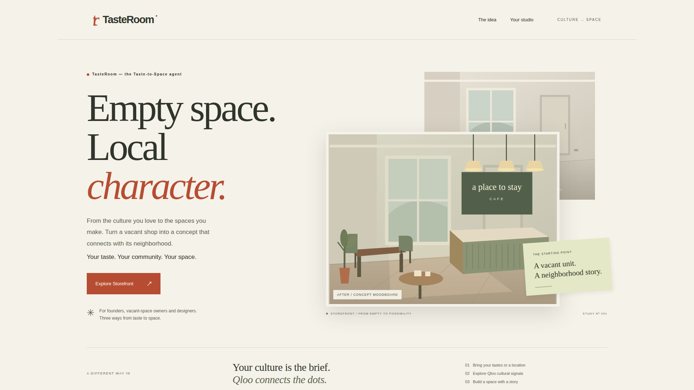
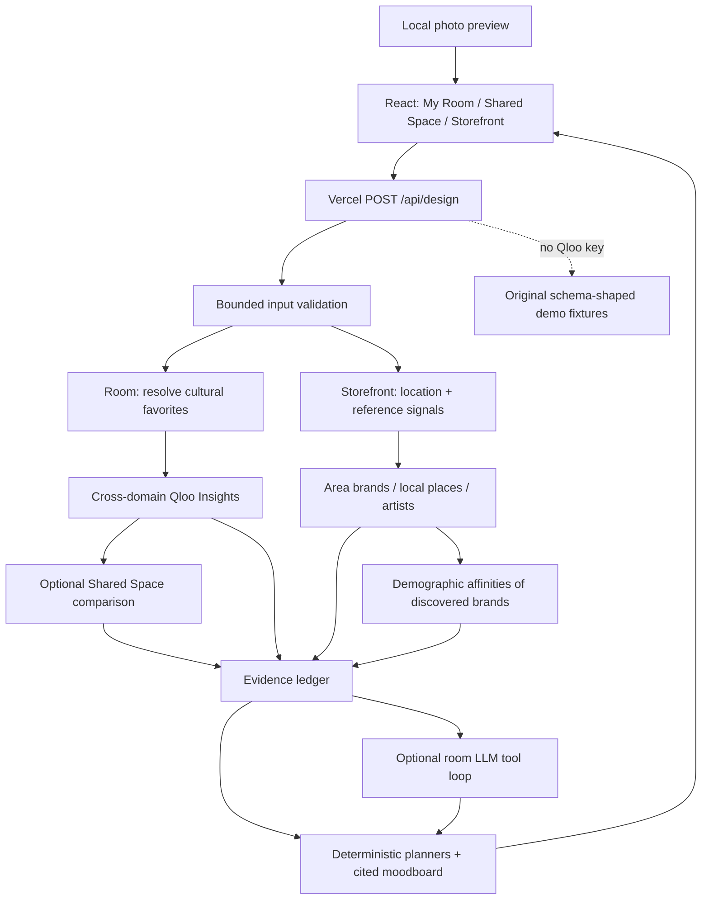

# TasteRoom — the Taste-to-Space agent

**Turn cultural taste into personal interiors, shared spaces and neighborhood storefront concepts.**

[Live demo](https://tasteroom-rho.vercel.app) · [GitHub](https://github.com/kks0488/tasteroom)



## Problem

People can name the films, music, brands and places they love but struggle to translate that taste into a space. Two people need common ground for a shared home. Founders and owners of vacant commercial units need a concept that connects with the surrounding community, beyond a generic style prompt.

## Solution

TasteRoom offers three modes, with a visible taste trace behind its creative choices:

- **My Room:** 3–5 cultural favorites become an interior style brief, color and finish palette, furniture/decor directions, lighting scenes, a moodboard and a shopping checklist.
- **Shared Space:** compare two taste profiles, find shared cultural anchors and preserve individual corners.
- **Storefront:** bring an empty-space photo, neighborhood/city, business type and optional brand references. Get three name ideas, an interior concept, palette, materials, day/night lighting, signature zone, music direction, menu/product direction, an opening event and a rough fit-out budget by category.

Storefront is the featured demo. Try **Seongsu-dong, Seoul → Cafe → Create store concept**. Upload a JPG, PNG or WebP under 8 MB, or use the supplied original neutral shop illustration. Photos stay in the browser: only the neighborhood, business type, assumed floor area and references reach the server. Dimensions displayed are image pixels, not room measurements. The after image is an original concept illustration, not a reconstruction of the uploaded photo.

Homeowners, interior designers and furniture retailers can use the room modes. Landlords, brokers with vacant units, small founders and interior designers can use Storefront. Built by Kyoungsoo Kim, an architecture graduate holding the Korean national certificate **Industrial Engineer, Interior Architecture**.

## Why Qloo is essential

Qloo supplies cross-domain cultural relationships. Room modes resolve favorites and explore brand, place, artist, book and tag affinities. Shared Space uses Analysis Compare to find common anchors. Storefront uses location signals to discover area-affinity brands/artists and geographically filtered places, then requests demographic affinities for discovered brands. Ranked signals select the design direction; every creative section links back to returned evidence.

The translation into interiors is TasteRoom's interpretation. Qloo does not measure furniture suitability, interior performance, construction cost or likely sales. Demographic scores are **signed affinities**, not percentages, population counts or a census of the neighborhood. They describe the audiences of discovered affinity entities and provide hypotheses to validate with local visitors. The concept welcomes all customers.

### Documented API contract

Server-side requests use `GET https://hackathon.api.qloo.com` with `X-Api-Key`:

| Purpose | Endpoint | Parameters |
| --- | --- | --- |
| Resolve tastes/references | `/search` | `query`, `take` |
| Cross-domain room insights | `/v2/insights` | `filter.type`, `signal.interests.entities`, `take` |
| Shared anchors | `/v2/analysis/compare` | `a.signal.interests.entities`, `b.signal.interests.entities`, `filter.type`, `take` |
| Area brand/artist insights | `/v2/insights` | `filter.type`, `signal.location.query`, optional `signal.interests.entities`, `take` |
| Local place insights | `/v2/insights` | `filter.type=urn:entity:place`, `signal.location.query`, `filter.location.query`, optional reference IDs, `take` |
| Audience affinities | `/v2/insights` | `filter.type=urn:demographics`, `signal.interests.entities` from discovered brands |

The location builder also supports coordinate objects using WKT `POINT(longitude latitude)` via `signal.location` / `filter.location`, with optional radii in meters. The UI uses neighborhood/city text. Geographic filters apply only to place results here; location signals rank brand/artist affinities. Default radius is left to Qloo's density discovery.

Official documentation was read with **curl**: [location insights](https://docs.qloo.com/reference/insights-with-location-use-case), [demographic insights](https://docs.qloo.com/reference/demographics-use-case), [parameters](https://docs.qloo.com/reference/parameters), [search](https://docs.qloo.com/reference/get-search), [tag taste analysis](https://docs.qloo.com/reference/taste-analysis), [Analysis Compare](https://docs.qloo.com/reference/analysis-compare), and [hackathon guide](https://docs.qloo.com/reference/qloo-llm-hackathon-developer-guide). The brief's older `/reference/location-based-insights` URL currently returns 404; the canonical location guide above was used.

Fixtures follow these documented collection shapes: search/compare `results[]`; Insights `results.entities[]` (including `entity_id`, `tags`, `query.affinity`); tag analysis `results.tags[]`; demographics `results.demographics[]` with `entity_id`, `query.age` and `query.gender`. Age keys are `24_and_younger`, `25_to_29`, `30_to_34`, `35_to_44`, `45_to_54`, `55_and_older`. Every demo name, ID and score is fictional. Location-dependent fixture ranking demonstrates the flow, not actual knowledge of a city. Unknown demo references are rejected.

## Architecture



Each request owns a Qloo client with caching, in-flight deduplication, a 32-call limit and 8-second upstream timeouts. Room LLM reasoning is bounded to three rounds and 10-second provider timeouts. Storefront uses the deterministic planner with actual returned signals when live mode is enabled. The app does not persist profiles, photos or live Qloo responses. Source paths: `server/qloo.js`, `server/fixtures.js`, `server/agent.js`, `server/storefront.js`, `src/main.jsx`, `src/StoreArt.jsx`.

## Run and test

Requires Node 22.12+. On a low-memory Mac, run installs, builds, dev servers and Playwright on `pilot`.

```sh
npm ci
npm test
npm run build
npm run dev
# http://127.0.0.1:4173
```

The keyless app works immediately. Room sample A: The Quiet Atlas / Low Tide Radio / North Window House. Sample B: Paper Sun Parade / Sunday Brass Club / Clay Market Kitchen. Storefront's optional sample brand reference: Field Notes Press.

`npm test` covers existing room behavior, shared comparison, LLM citations/fallback, Qloo contracts, location parameters and Storefront validation, evidence, audience data, changed location/business, budget arithmetic and live failures. `.github/workflows/ci.yml` runs unit tests, the production build and a history secret scan.

### Environment and live mode

Read `.env.example`; all secret values are empty. Set variables in the server environment. For local use: `node --env-file=.env server/dev.js`. Never use a `VITE_` prefix for secrets.

| Variable | Behavior |
| --- | --- |
| `QLOO_API_KEY` | Automatically selects live Qloo calls. Unset selects clearly labeled synthetic demo fixtures. |
| `LLM_BASE_URL` | OpenAI-compatible base URL; defaults to `https://api.tokenfactory.nebius.com/v1/`. |
| `LLM_API_KEY` | Enables the optional room LLM loop when a model is also set. |
| `LLM_MODEL` | Exact available provider model ID; no model availability is assumed. |

The [official Nebius quickstart](https://docs.tokenfactory.nebius.com/quickstart) confirms the default endpoint. [Gemini's OpenAI compatibility](https://ai.google.dev/gemini-api/docs/openai) can be configured with `https://generativelanguage.googleapis.com/v1beta/openai/` and an appropriate model. No paid calls or provider signup were performed. LLM failures show a visible notice and retain the Qloo-grounded deterministic room brief. Failed live Qloo calls never silently switch to demo success.

### Browser captures and deployment

Run on pilot with a matching Playwright browser (or set `CHROMIUM_PATH` to the installed Chromium):

```sh
# Start a time-bounded dev server, then stop it after capture.
timeout 240s npm run dev
# In another terminal:
CHROMIUM_PATH="$HOME/.cache/ms-playwright/chromium-1228/chrome-linux64/chrome" RECORD_VIDEO=1 npm run test:e2e
```

The capture script records a dedicated **1920×1080 Storefront WebM** to `media/storefront-flow.webm` and PNG screenshots `media/09-storefront-hero.png` through `media/16-mobile-storefront.png`. It verifies local-only photo upload, location/audience traces, the budget, 390px layout, personal/shared regression flows, error handling and axe accessibility checks. `media/verification.json` records the checked URL and results. The footage is a real browser recording for the separate Remotion workflow, not a final promotional video.

Before each push: `gitleaks detect --source . --redact` and `gitleaks git --redact`. Deploy with the logged-in CLI: `vercel --prod --yes`. No Devpost submission is performed.

## What was built during the hackathon

The original studio, conceptual room artwork, Qloo client and fixtures, agent orchestration, optional LLM tools, evidence ledger, Shared Space, room-specific briefs, export/checklist, tests, CI, captures and deployment were created for the 2026 Qloo Agentic Hackathon. The v2 extension adds Taste-to-Space positioning, three mode cards and Storefront: original vacant-shop artwork, local photo preview, location/audience research, a cited commercial concept, assumed-area budget, tests and captured footage. React, Vite and test tools are open source dependencies; their upstream work is not claimed as ours.

## Limits and assumptions

The hosted keyless demo uses synthetic evidence. Real Qloo and LLM behavior still requires owner-supplied keys; mocked contract tests do not verify live service access or geographic coverage. Qloo's account permissions can affect available endpoints and domains. Room design uses a compact set of directions; Storefront also uses bounded original concept templates selected by ranked signals. Name ideas need local availability checks. Recommendations are generic directions, not purchasable stock or copied products.

Budget assumes **50 m² by default**, an existing serviced shell and mid-range finishes. It is an illustrative **USD rough estimate, not a quote**, with explicit exclusions and editable area; it is not localized construction pricing. No measurements, structural assessments, local approvals or commercial viability are inferred. Public API usage has per-request bounds but no durable cross-instance abuse throttle; configure provider quotas before enabling public paid keys.

All demo artwork and fictional cultural names are original. No scraped content, third-party media or third-party demo logos are included. No accounts were registered or money spent.

## License

MIT — Copyright (c) 2026 Kyoungsoo Kim. See [LICENSE](LICENSE).
